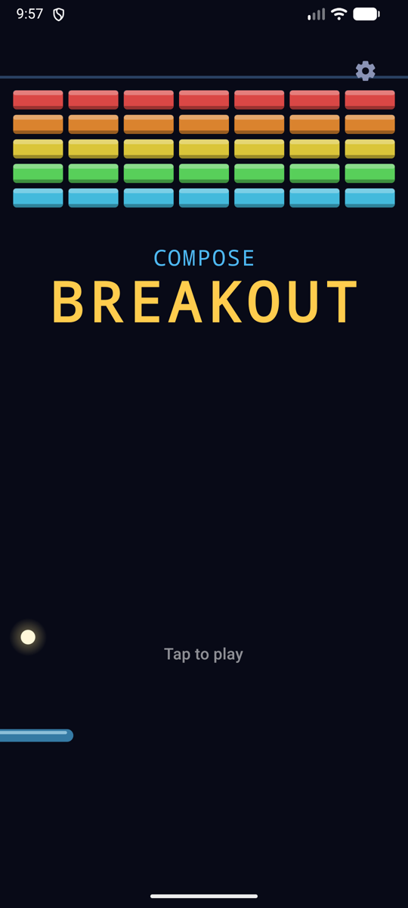
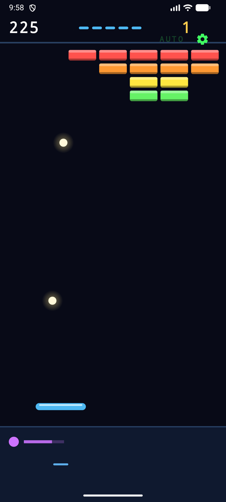
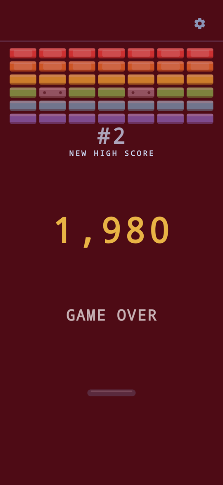
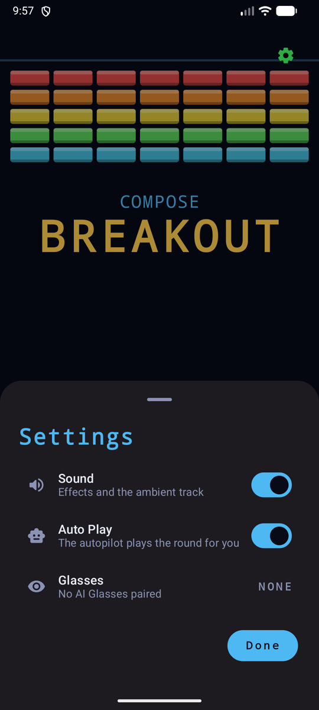
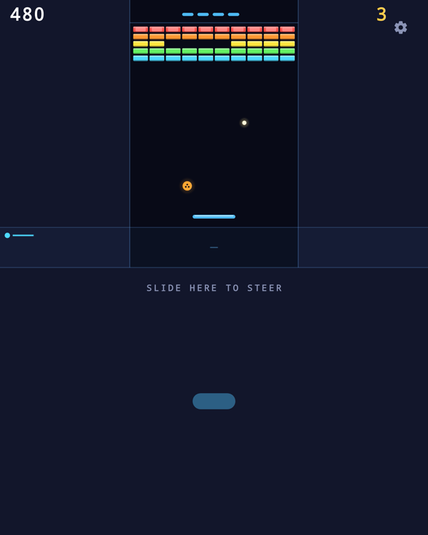
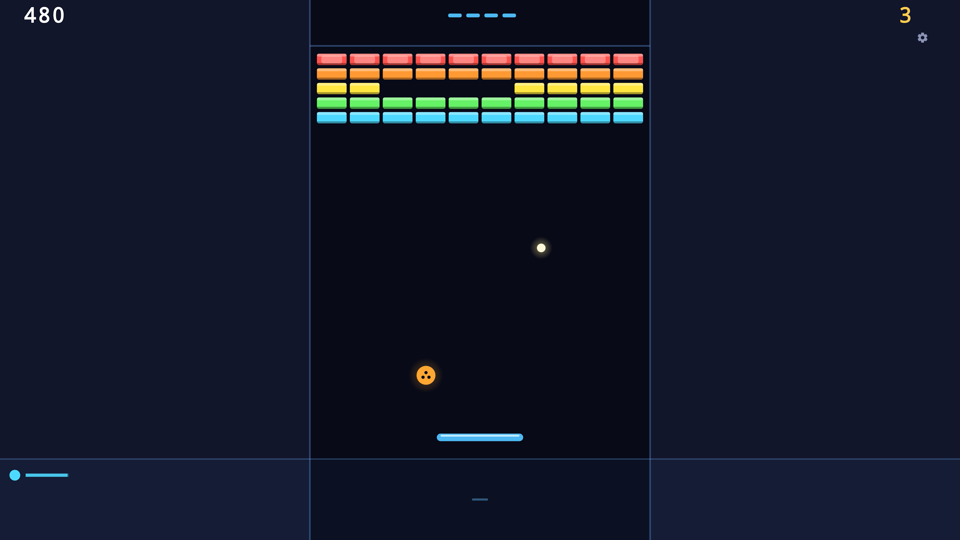
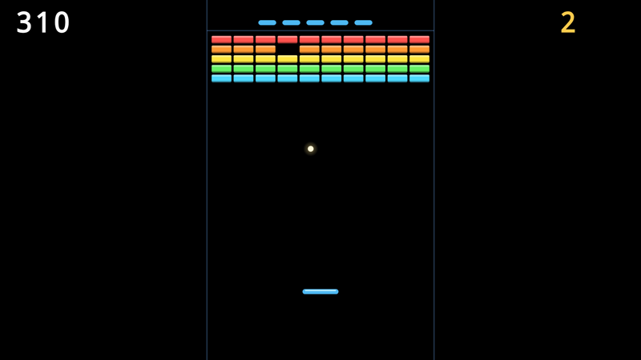
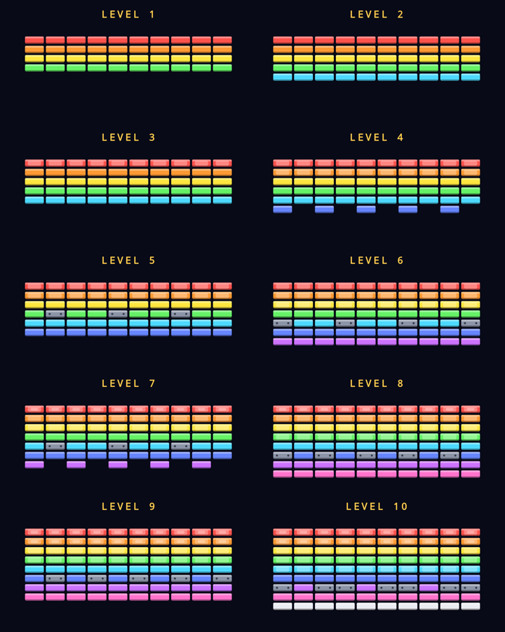

# Compose Breakout

[](https://github.com/jpcottin/ComposeBreakout/actions/workflows/ci.yml)

A **Breakout-like** game written entirely in **Kotlin** and **Jetpack
Compose**, adaptive from a phone to a foldable, a tablet, Android XR and a TV
with a D-pad — and playable on Display AI Glasses when a pair is connected.

The game is drawn on a Compose `Canvas`; everything around it (the HUD, the
title, the settings sheet, the end screens) is Material 3. The game itself is
a pure-Kotlin module with no Android in it, so its tests and the Auto Play
bench run on any JVM in seconds. Sibling of
[VulkanBreakout](https://github.com/jpcottin/VulkanBreakout), the same game
with a hand-written Vulkan renderer.

> **Status:** complete — ten levels, the four bonuses, the high-score
> table, the end screens, sounds and haptics, Auto Play, and it plays on a
> phone, a foldable (open, closed or half-opened), a tablet, an XR panel, a
> TV with a D-pad and a pair of AI Glasses.

## Screenshots

| Title | Auto Play, two balls up, the slow-ball bar | Game over, a new high score |
|---|---|---|
|  |  |  |

| Settings | Foldable, half-opened: the control surface below the hinge |
|---|---|
|  |  |

| TV, 1080p, the lane in the middle | AI Glasses: black background, no gear |
|---|---|
|  |  |

The phone captures come from an Android emulator; the foldable, TV and
glasses pictures are the screenshot tests' own renders.

## The game

- **Ten levels**, easy to hard: 4 rows of bricks at level 1, 9 at level 10,
  the ball a little faster each level and faster still as the wall thins.
  Tough bricks (two hits) arrive at level 3, steel (never breaks, does not
  count) at level 5, armour (three hits) at level 7.

  

  The picture is the `LevelsGallery` composable, a preview and a screenshot
  test drawn by the same code that draws the game: a change to a level's
  layout is seen, not guessed.
- **Controls:** the strip below the paddle steers — the paddle slides toward
  the finger — and any tap launches the ball resting on the paddle. The
  bounce angle follows where the ball meets the paddle: centre sends it up,
  the tips 65 degrees out. That is the aim. With a D-pad, a remote or a
  keyboard, left and right steer at the same speed and OK / Enter / Space
  launches; Up reaches the gear, Down comes back. On a half-opened foldable
  the game sits above the hinge and the whole lower half is the steering
  surface.
- **Pause:** a round in flight freezes when the screen goes away (the app
  goes to the background, Settings opens) and waits for a tap — PAUSED,
  then tap, OK or the touchbar to resume. The autopilot resumes by itself,
  so an unattended run keeps going.
- **Bonuses** drop from broken bricks: a wide paddle (10 s), a slow ball
  (8 s), multi-ball (every ball splits in three, up to six) and an extra
  life (up to nine). Five lives to start.
- **Scoring:** 10 / 20 / 30 points per brick kind times the level, 25 times
  the level per bonus, 100 times the level per cleared wall. The top five
  scores are kept; the top three show on the title screen.
- **Auto Play** (Settings): the autopilot plays the round. It works out
  where each ball comes down, gets the paddle there, and picks *where on
  the paddle* to take it so the rebound does the most damage: every
  candidate hit offset is flown against the wall with the real collision
  rules, scored by bricks hit per second of flight, and rejected when its
  own landing could not be caught in time. A rebound that hits nothing is
  judged one trip further, so the last brick in a corner still gets
  reached. Predictions are cached per ball and redone only on a bounce.
  Capsules are collected when the detour leaves time to be back under the
  ball. The gear turns green while it plays.
- **Sounds**, all synthesised in real time (no audio files): a bright blip
  off the paddle, a dull tick off the walls, a click for a brick that holds
  and a pitched pop for one that breaks — one semitone per row, the top
  row highest, so the wall is a keyboard — a slide down for a lost ball, a
  rising arpeggio for a cleared level, a sparkle for a bonus, a jingle for
  an extra life, and a quiet ambient track (a pad, a bass on beats one and
  three, an arpeggio) from the first serve to the end screen. A lost ball
  is also a heavy click from the vibrator. The Sound switch silences all of
  it.
- **Play on AI Glasses:** with Display Glasses paired, Settings shows a
  Glasses row — *PLAY* hands the game to the glasses' projected display,
  where the **touchbar** drives it: finger position steers the paddle,
  contact launches the ball. The phone shows an "ON GLASSES" banner over
  its frozen field; *PHONE* (in Settings) brings the game home. With
  nothing paired the row reads *NONE*.

## Modules

| Module | What it is |
|---|---|
| `:engine` | The game: the world's geometry, the ten levels, the simulation (substepped collision, bonuses, scoring, high scores), the Auto Play autopilot, and the synth that makes every sound. Pure Kotlin (`kotlin("jvm")`), no Android. JUnit tests; the bench is its `main` (`./gradlew :engine:run`). |
| `:app` | The Compose shell: `MainActivity`, the `Canvas` playfield, Material 3 chrome, device traits, DataStore for settings and high scores, previews, screenshot tests, instrumented tests. |

## Tech

- **Jetpack Compose + Material 3** — Settings is a `ModalBottomSheet` on a
  phone and a centred dialog card on an expanded window (a tablet, a TV, an
  XR panel), chosen from the window size class; `Switch` rows,
  `IconButton`s, Material typography and a fixed dark colour scheme
  (`theme/`).
- **One `Canvas`, one world** — the engine keeps world coordinates (x in
  [-aspect, aspect], y in [-1, 1], y down); the canvas maps them with one
  scale around the centre, so a world unit is square on every screen and the
  engine never sees a pixel. The frame loop is `withFrameNanos` in a
  `LaunchedEffect`: one engine step per vsync with the real elapsed time.
- **Device traits, not form-factor labels** — Compose's `mediaQuery { }`
  decides the inputs and margins from what the device can do: viewing
  distance drives overscan margins and larger HUD text, pointer precision
  decides between "tap" and "press OK" hints, window posture drives the
  tabletop layout on foldables. Previews fall back to `uiMode` when the
  Application class is not around.
- **A screen reader hears the round** — the playfield carries a state
  description (level, bricks left, lives) and a polite live region names
  each event once: a level begins or is cleared, a ball is lost, the game
  ends, the round pauses. The HUD's score, lives and level are labelled.
- **Keys and focus** — the playfield is a focusable node that turns D-pad
  and keyboard events into engine steering (held key = paddle sliding at
  its usual speed, like a finger on the strip); it holds focus while the
  game runs and takes it back when the settings sheet closes, so a TV never
  loses its cursor.
- **Styles API** — the focus ring on the gear and the settings rows is a
  Compose `Style` driven by the component's `InteractionSource`, so a TV
  remote or a keyboard always shows where focus is.
- **The lane** — a wide screen (landscape, an unfolded foldable, a tablet, an
  XR panel) plays in a central lane of at most 10 brick columns with shaded
  margins, rather than a wall three times wider than a paddle can cover.
- **DataStore** for settings and the high-score table; the engine reports
  changes through a `GameHost` interface and never touches storage itself.
  A round in progress survives process death: the `ViewModel` registers a
  saved-state provider and the next instance resumes level, score and lives
  with a fresh wall.
- **A synth, not samples** — the engine's `Synth` renders eight effect
  voices and the ambient track into float blocks; the app's `AudioOutput`
  pushes them to a low-latency mono `AudioTrack` at the device's native
  rate from its own thread, paused with the activity through
  `LifecycleResumeEffect`. The game thread only flips a bit mask, so it
  never waits on audio. The synth's tests check every effect sounds and
  ends, the brick pop carries its pitch, the mix never clips and the track
  keeps its level after ten minutes.
- **AI Glasses (Android XR projected)** — the glasses expose a secondary
  display owned by a virtual device. `GlassesSession` uses
  `androidx.xr.projected` to observe pairing and to launch
  `GlassesActivity` — the same Compose screen, declared with
  `requiredDisplayCategory="xr_projected"` — onto that display. The glasses
  activity runs its own engine in touchbar mode, with no gear and a pure
  black background (transparent on additive AR lenses); the phone's engine
  freezes under a banner while the session flag is set and adopts the
  glasses' high scores when it clears. The two instances share the
  DataStore, so a save from either folds the other's rows in.
- **Chrome placed in world coordinates** — the HUD overlays (title, launch
  hint, level banner, end screens, bonus flash) use a layout modifier that
  puts an element's centre at a world point, the same mapping the canvas
  uses, so text and shapes line up on every screen whatever the insets.
- **An icon that is the game** — adaptive launcher icon (bricks with a gloss,
  the ball mid-bounce with its trail, the paddle), a monochrome layer for
  themed icons, and a TV banner with the name set in a bitmap block font.
- AGP 9, Kotlin 2.4, Compose BOM 2026.09, `minSdk 26`, `compileSdk 37`.

## The Auto Play bench

The engine's `main` plays seeded, headless rounds with the autopilot and
reports how often it clears each level, how long it takes and how many
balls it loses. Every Auto Play change is measured here before it ships:

```bash
./gradlew :engine:run --args="--runs 100 --levels --campaigns"        # portrait phone
./gradlew :engine:run --args="--width 2400 --height 1080 --runs 50 --campaigns"
./gradlew :engine:run --args="--runs 1 --levels --trace"              # the scene at every lost ball
```

CI runs it with `--min-campaign-win 95` on a portrait phone and a landscape
screen: fewer than 95% of campaigns won fails the build.

## Build & run

```bash
./gradlew assembleDebug
adb install -r app/build/outputs/apk/debug/app-debug.apk
adb shell am start -n com.jpcottin.composebreakout/.MainActivity
```

## Testing

```bash
./gradlew :engine:test                       # the game, on the JVM
./gradlew :app:testDebugUnitTest             # the app's JVM tests
./gradlew :app:validateDebugScreenshotTest   # Compose preview screenshots against the references
./gradlew :app:updateDebugScreenshotTest     # re-record the references after a deliberate change
./gradlew :app:connectedDebugAndroidTest     # instrumented tests on a device or emulator
```

The screenshot tests render the `@Preview`s in `app/src/screenshotTest` —
every screen of the game (title, in play, served ball, level clear, game
over, win, settings) on phone, foldable, tablet and TV — and compare them
with the references committed under `app/src/screenshotTestDebug/reference`.
The engine is seeded and stepped deterministically, so each preview is the
same picture every time.

The instrumented test drives the real activity with a paused test clock
(the game steps once per frame for as long as it is on screen, which the
Compose test harness would otherwise read as "never idle").

## CI/CD

GitHub Actions runs on every push and pull request to `main`. The gating
jobs must pass; the experimental ones run non-blocking and their results
are read.

| Job | What it does | Gates |
|-----|-------------|-------|
| **Build, lint, tests, screenshots** | Engine JUnit tests, Android lint, app unit tests, Compose preview screenshot validation, the debug and the minified release APK (`apks` artifact) | yes |
| **Auto Play bench** | Seeded campaigns with the autopilot on a portrait phone (100) and a landscape screen (50); fails under a 95% campaign win rate | yes |
| **Instrumented** | The instrumented tests (title, a round by tap and by D-pad, the settings sheet) on emulators: phones at API 33, 34, 35 and 36, a foldable and a TV at API 36 — on the lavapipe software Vulkan GPU or the emulator's auto choice, with `-delay-adb` so a device going offline mid-boot cannot fail a leg | yes |
| **Instrumented, experimental** | The same tests on an XR headset (API 34, `google-xr`), on a swiftshader comparison leg, and on the API 37.0, 37.1 and 37.2 page-size-16k images with the stable and canary emulators, lavapipe and auto GPU | no |
| **Android CLI experiment** | The whole emulator flow through the Android CLI (`android sdk install`, `android emulator create/start/stop`) on the canary emulator, API 37.0 and 37.2 | no |
| **Emulator Preview experiment** | The `emulators;latest` preview package launched by its own binary, API 37.0 and 37.2 | no |
| **Emulator Preview multi-run** / **Android CLI multi-run** | Four boot cycles with snapshots: the game is launched once with Auto Play (`--ez autoplay true`), each cycle shuts the emulator down gracefully, and the next one checks the app is still running, drawing, and that the score read from the HUD did not go back | no |

The multi-runs use the launch extra `adb shell am start -n
com.jpcottin.composebreakout/.MainActivity --ez autoplay true`, which turns
Auto Play on and starts a round: a way to watch the game play itself from
the command line.

## License

[Apache License 2.0](LICENSE).
